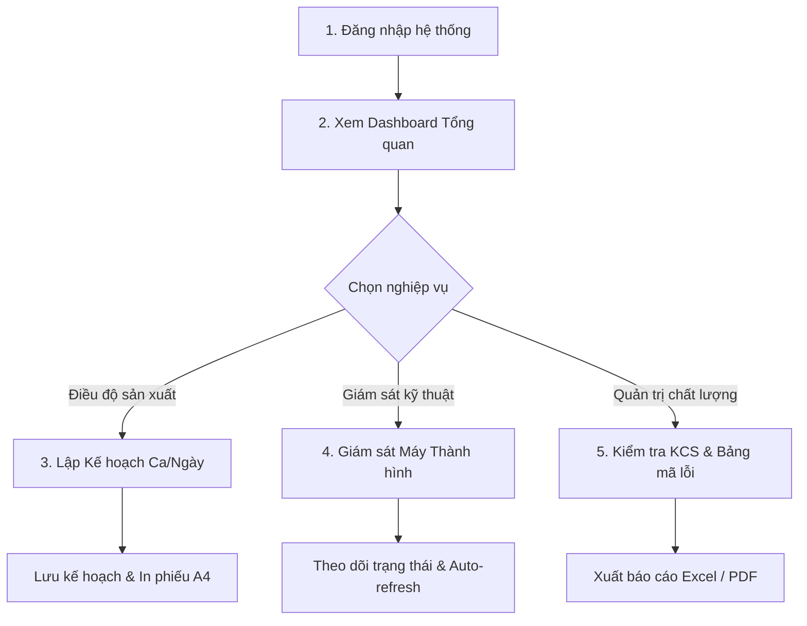

# 📘 CẨM NANG HƯỚNG DẪN SỬ DỤNG HỆ THỐNG MES DRC (KÈM HÌNH ẢNH TRỰC QUAN)

**HỆ THỐNG GIÁM SÁT SẢN XUẤT SCADA & MES**  
**CÔNG TY CỔ PHẦN CAO SU ĐÀ NẴNG (DRC) — XÍ NGHIỆP RADIAL — XƯỞNG CẮT VẢI & THÀNH HÌNH (CVTH)**

---

> 💡 **Cách xem hướng dẫn trực quan dạng Web tương tác:**  
> - Nếu dự án đang chạy (`npm run dev`), bạn có thể mở trực tiếp link: [http://localhost:5173/HUONG_DAN_SU_DUNG_MES.html](http://localhost:5173/HUONG_DAN_SU_DUNG_MES.html)  
> - Hoặc mở file HTML đính kèm bằng trình duyệt: [public/HUONG_DAN_SU_DUNG_MES.html](file:///d:/CTY/cake-shop-frontend-chính-20251014T092929Z-1-001/cake-shop-frontend-chính/public/HUONG_DAN_SU_DUNG_MES.html)

---

## 📑 MỤC LỤC HƯỚNG DẪN
1. [Màn hình Đăng nhập (Authentication)](#1-màn-hình-đăng-nhập-authentication)
2. [Cấu trúc cây Menu điều hướng (Sidebar Navigation)](#2-cấu-trúc-cây-menu-điều-hướng-sidebar-navigation)
3. [Màn hình Tổng quan Dashboard (Index)](#3-màn-hình-tổng-quan-dashboard-index)
4. [Màn hình Giám sát Thiết bị & Máy Thành Hình](#4-màn-hình-giám-sát-thiết-bị--máy-thành-hình)
5. [Màn hình Lập kế hoạch sản xuất Ca / Ngày (Thành hình)](#5-màn-hình-lập-kế-hoạch-sản-xuất-ca--ngày-thành-hình)
6. [Màn hình Kế hoạch - Sản xuất Năm 2026](#6-màn-hình-kế-hoạch---sản-xuất-năm-2026)
7. [Màn hình Kế hoạch cắt vải thép (Ca / Ngày)](#7-màn-hình-kế-hoạch-cắt-vải-thép-ca--ngày)
8. [Màn hình Thống kê Kiểm soát Chất lượng KCS (KS.1.1)](#8-màn-hình-thống-kê-kiểm-soát-chất-lượng-kcs-ks11)
9. [Màn hình Danh mục Bảng mã lỗi Khuyết tật Lốp](#9-màn-hình-danh-mục-bảng-mã-lỗi-khuyết-tật-lốp)

---

## 1. Màn hình Đăng nhập (Authentication)

Giao diện đăng nhập bảo mật của hệ thống quản trị sản xuất MES DRC.

### 🔍 Giải thích chi tiết từng nút bấm & ô nhập liệu:

| Số thứ tự | Tên nút / Ô nhập liệu | Loại phần tử | Ý nghĩa & Hướng dẫn thao tác |
| :---: | :--- | :--- | :--- |
| **1** | **TÊN ĐĂNG NHẬP** | Ô nhập văn bản (Input) | Nhập tên tài khoản hoặc mã số nhân viên kỹ thuật (ví dụ: `admin`, kỹ sư ca). |
| **2** | **MẬT KHẨU** | Ô nhập mật khẩu (Password) | Nhập mật khẩu tài khoản. Các ký tự được mã hóa hiển thị dạng dấu chấm để bảo mật. |
| **3** | **Quên mật khẩu?** | Đường dẫn (Link) | Nhấp vào đây khi quên mật khẩu để chuyển sang trang xác nhận cấp lại mã bảo mật qua Email nội bộ. |
| **4** | **Xác nhận đăng nhập** | Nút bấm chính (Xanh đậm) | Gửi yêu cầu đăng nhập lên hệ thống xác thực JWT. Khi thành công, hệ thống lưu phiên và tự động chuyển về trang Tổng quan. |
| **5** | **★ Đăng nhập trải nghiệm (Demo)** | Nút bấm nhanh (Xanh lá) | Nhấp nút này để vào thẳng hệ thống với tài khoản quản trị viên Demo, hỗ trợ xem nhanh giao diện phục vụ đào tạo mà không phụ thuộc CSDL. |
| **6** | **ĐĂNG KÝ MỚI** | Đường dẫn (Link) | Chuyển đến biểu mẫu đăng ký tài khoản người dùng mới cho công nhân / kỹ sư mới vào xưởng. |

---

## 2. Cấu trúc cây Menu điều hướng (Sidebar Navigation)

Thanh menu nằm cố định ở lề trái màn hình, tổ chức theo mô hình cây phân cấp chuẩn MES từ Cấp 1 đến Cấp 5.

### 🔍 Ý nghĩa từng nhánh danh mục trên Menu:

1. **Logo & Tiêu đề:** `DRC System - Quản lý sản xuất` ở trên cùng.
2. **Gốc SCADAR (Cấp 1):** Cụm chức năng SCADA giám sát dây chuyền sản xuất lốp xe toàn xưởng.
3. **Nhánh DASHBOARD (Cấp 2):**
   - **TỔNG QUAN:** Màn hình điều hành chính toàn xưởng CV-TH.
   - **TRẠNG THÁI THIẾT BỊ:** Bảng theo dõi tình trạng máy chạy / dừng / lỗi.
   - **KẾ HOẠCH - SẢN XUẤT NĂM:** Thống kê theo dõi sản lượng 12 tháng trong năm.
   - **KẾ HOẠCH - SẢN XUẤT THÁNG / CA THÁNG:** Báo cáo chi tiết theo chu kỳ tháng.
   - **SẢN XUẤT 10 NĂM:** Đồ thị phân tích xu hướng tăng trưởng sản lượng dài hạn.
   - **TRẠNG THÁI MÁY (NGÀY / THÁNG / NĂM):** Lịch sử vận hành của thiết bị.
4. **Nhánh THÀNH HÌNH & CẮT VẢI (Cấp 2):**
   - **Nhánh con Thành hình (Cấp 3):**
     - *KH Thành hình (Cấp 4):* Lập KH theo tháng, Kiểm kê tồn kho đầu kỳ, Thống kê thực hiện kế hoạch tháng/máy, Lập kế hoạch thành hình Ca/ngày.
     - *Báo cáo KH thành hình (Cấp 4):* Hiển thị danh sách lốp, Báo cáo tổng hợp theo Ca/ngày, Ca/máy, Danh sách khối lượng lốp.
   - **Nhánh con Cắt Vải (Cấp 3):** Lập kế hoạch Ca/ngày cắt vải thép, Thống kê KHSX cắt vải theo ca/tháng, In phiếu BCP, Danh sách lốp nhập kho cắt vải.
5. **Nhánh LƯU HÓA (Cấp 2):** Phân hệ quản lý công đoạn hấp lưu hóa nhiệt độ cao.
6. **Nhánh KCS (Cấp 2):**
   - *Danh mục:* Bảng mã lỗi khuyết tật kỹ thuật.
   - *Báo cáo thống kê:* Thống kê KSCL lốp (OR.KS.D02, D05, D06), Tìm kiếm mã vạch lốp, Lịch sử chỉnh sửa, Lốp xử lý chưa nhập kho.
7. **Khu vực chân Sidebar:** Hiển thị Avatar, tên tài khoản đang online (ví dụ: *Kỹ Sư DRC MES*) và nút **Đăng xuất** (chữ đỏ).

---

## 3. Màn hình Tổng quan Dashboard (Index)

Màn hình chỉ huy trung tâm cập nhật tức thời nhịp độ sản xuất của xưởng Cắt Vải - Thành Hình.

### 🔍 Ý nghĩa các khu vực & nút bấm:

| Khu vực | Thành phần | Ý nghĩa & Hướng dẫn sử dụng |
| :--- | :--- | :--- |
| **Góc trên phải** | **Nút [XUẤT BÁO CÁO (PDF)]** | Bấm để chụp lại toàn bộ màn hình Dashboard và tự động đóng gói thành file PDF in ấn phục vụ họp giao ban. |
| **Góc trên phải** | **Thẻ [CA 2 (14:00 – 22:00)]** | Hệ thống tự nhận diện ca làm việc hiện tại: Ca 1 (06h-14h), Ca 2 (14h-22h), Ca 3 (22h-06h). |
| **Khối bên phải** | **HIỆN TRẠNG THIẾT BỊ XƯỞNG CV-TH** | Bảng đếm số lượng máy theo 4 trạng thái màu: 🟢 **Running:** Máy đang chạy sản xuất bình thường. 🟡 **Stop:** Máy đang dừng chờ BTP hoặc nghỉ giữa ca. 🔴 **Fault:** Máy bị sự cố kỹ thuật cần can thiệp. 🟤 **Lost Connection:** Máy mất tín hiệu kết nối mạng PLC/SCADA. |
| **Khối giữa** | **TÌNH HÌNH SẢN XUẤT XƯỞNG CV-TH** | 3 khối hiển thị tiến độ % hoàn thành, số lượng Kế hoạch (KH) và Sản xuất thực tế (SX) cho 2 công đoạn **THÀNH HÌNH** và **CẮT VẢI** trong: (1) Ca hiện tại, (2) Tháng hiện tại, (3) Năm hiện tại. |
| **Khối chân trang** | **BIỂU ĐỒ THEO DÕI KẾ HOẠCH NĂM** | Đồ thị cột thể hiện mức độ bám sát chỉ tiêu sản lượng theo từng tháng. |

---

## 4. Màn hình Giám sát Thiết bị & Máy Thành Hình

Giám sát chi tiết thông số vận hành và sản lượng của từng máy thành hình trong xưởng.

### 🔍 Giải thích chi tiết các nút bấm & tính năng:

- **Hệ thống 4 Tab chức năng trên cùng:**
  1. *Trạng thái máy và sản lượng:* Xem tổng quan tình trạng thực tế của tất cả máy thành hình.
  2. *Lịch sử thông số cài đặt:* Xem công thức đóng lốp (recipe) đã được nạp xuống máy.
  3. *Lịch sử thông số hoạt động:* Xem chu kỳ ép lốp, áp suất khí nén, dòng điện động cơ.
  4. *Lịch sử thông số thay đổi:* Nhật ký ghi lại những thay đổi thông số máy của ca trước.
- **Thanh bộ lọc thời gian:**
  - *Từ Ca / Đến Ca:* Lọc dữ liệu theo ca sản xuất (Ca 1, Ca 2, Ca 3).
  - *Ngày:* Chọn ngày cần xem lại lịch sử máy.
  - *Nút [XUẤT BÁO CÁO (PDF)]:* Kết xuất báo cáo trạng thái máy ra file PDF.
  - *Dropdown "Tự động làm mới":* Đặt chu kỳ tự quét dữ liệu sau mỗi 20 giây, 1 phút hoặc 5 phút để bảng điều khiển luôn cập nhật dữ liệu mới nhất từ xưởng.
- **Thẻ chỉ số trạng thái (KPI Cards):** Đếm tổng số máy, số máy Đang chạy, Đang dừng SX, Bị lỗi, Mất kết nối PLC. Nhấp trực tiếp vào thẻ máy cụ thể để vào màn hình chi tiết máy đó.

---

## 5. Màn hình Lập kế hoạch sản xuất Ca / Ngày (Thành hình)

Giao diện để Quản đốc / Kỹ sư điều độ nhập chỉ tiêu quy cách lốp cần đóng trong từng ca sản xuất.

### 🔍 Giải thích chi tiết các nút bấm & trường dữ liệu:

1. **Thanh công cụ tác vụ trên cùng:**
   - **Nút [LƯU KẾ HOẠCH] (Icon đĩa mềm):** Bấm nút này sau khi đã điền xong thông tin và các dòng quy cách. Hệ thống sẽ kiểm tra tính hợp lệ và ghi dữ liệu vào máy chủ để phân bổ xuống máy sản xuất.
   - **Nút [Làm trống] (Icon thùng rác đỏ):** Xóa toàn bộ dữ liệu đang nhập trên biểu mẫu để lập kế hoạch mới.
   - **Nút [In] (Icon máy in):** Xuất lệnh sản xuất ra giấy in khổ A4 ngang để ký duyệt và giao cho tổ trưởng sản xuất.
2. **Khối "THÔNG TIN KẾ HOẠCH CHUNG":**
   - **ID Kế Hoạch:** Mã định danh duy nhất của ca (ví dụ: `RA10.202609141` -> Kho RA10, ngày 14/09/2026, Ca 1).
   - **Ngày KHSX:** Lựa chọn ngày sản xuất.
   - **Ca \*:** Chọn ca làm việc (Ca 1, Ca 2, Ca 3).
   - **Mã Kho:** Mã kho quản lý lốp thành hình (`RA10`).
   - **Máy Thực Hiện \*:** Chọn máy thành hình (ví dụ: `TH-01`, `TH-02`...).
   - **Người lập biểu:** Tên kỹ sư lập biểu (tự động điền theo tài khoản đăng nhập).
   - **Lưu ý chung:** Ô nhập các chỉ đạo kỹ thuật đặc biệt cho ca (ví dụ: chú ý nguyên liệu lô mới, chuẩn bị chuyển đổi quy cách lốp).
3. **Khối "CHI TIẾT SẢN XUẤT TRÊN MÁY (TỐI ĐA 7 DÒNG QUY CÁCH)":**
   - **Mã Quy Cách:** Nhập mã sản phẩm lốp (hệ thống hỗ trợ tự gợi ý mã khi nhập).
   - **Tên Quy Cách:** Tên thương phẩm đầy đủ của lốp xe.
   - **SL Kế Hoạch:** Số lượng lốp chỉ tiêu cần đạt được trong ca.
   - **SL Điều Chỉnh:** Số lượng bổ sung hoặc giảm trừ trong trường hợp có biến động phát sinh trong ca.
   - **Ghi Chú:** Ghi chú kỹ thuật riêng cho từng mã quy cách.

---

## 6. Màn hình Kế hoạch - Sản xuất Năm 2026

Báo cáo phân tích chiến lược tổng thể theo năm của cả 2 công đoạn Cắt vải và Thành hình.

### 🔍 Hướng dẫn sử dụng & Quy ước màu sắc KPI:

- **Bộ điều khiển góc trên:**
  - *Năm sản xuất:* Chọn năm cần thống kê (ví dụ: `Năm 2026`).
  - *Nút [Refresh]:* Tải lại số liệu tổng hợp mới nhất từ máy chủ.
  - *Nút [Mặc định]:* Hoàn tác tất cả bộ lọc về cấu hình ban đầu.
  - *Nút [XUẤT BÁO CÁO (PDF)]:* Xuất toàn bộ báo cáo phân tích năm thành file PDF.
- **Tiến độ hoàn thành:**
  - *CÔNG ĐOẠN CẮT VẢI (CV):* Thống kê theo đơn vị BTP (Bán thành phẩm).
  - *CÔNG ĐOẠN THÀNH HÌNH (TH):* Thống kê theo đơn vị Lốp.
- **Quy ước màu sắc trên biểu đồ cột 12 tháng:**
  - 🟢 **Xanh đậm (>100%):** Vượt chỉ tiêu kế hoạch.
  - 🟢 **Xanh tươi (=100%):** Hoàn thành chuẩn 100% kế hoạch giao.
  - 🟢 **Xanh nhạt (80% - <100%):** Mức Khá, tiệm cận kế hoạch.
  - 🟠 **Cam (50% - <80%):** Mức Trung bình, cần đôn đốc tăng ca.
  - 🔴 **Đỏ (<50%):** Báo động tiến độ chậm, chưa đạt chỉ tiêu.

---

## 7. Màn hình Kế hoạch cắt vải thép (Ca / Ngày)

Quản lý kế hoạch gia công bán thành phẩm mành vải thép cho tổ Cắt Vải.

### 🔍 Các nút thao tác & cột dữ liệu quan trọng:

- **Nút [Làm mới]:** Tải lại bảng kế hoạch cắt vải mới nhất.
- **Nút [Xuất Excel]:** Xuất toàn bộ danh sách ra file bảng tính Excel (`.xlsx`).
- **Bộ lọc Ngày & Ca -> Nút [Tìm kiếm]:** Nhập ngày sản xuất và ca làm việc để lọc ra kế hoạch tương ứng.
- **Các cột dữ liệu chính:**
  - *Tên BTP / Ký hiệu BTP / Loại BTP:* Phân loại bán thành phẩm mành vải thép.
  - *Máy:* Số hiệu máy cắt vải.
  - *Số lượng KH / SL KH Điều chỉnh / Số lượng SX:* So sánh giữa chỉ tiêu và thực tế.
  - *Số lượng Thiếu:* Hiển thị số BTP còn thiếu cần cắt gấp để không làm gián đoạn tổ Thành hình.

---

## 8. Màn hình Thống kê Kiểm soát Chất lượng KCS (KS.1.1)

Phân hệ tra cứu và phân loại chất lượng lốp theo biểu mẫu OR.KS.D02.

### 🔍 Giải thích thanh công cụ & bộ lọc:

- **Thanh công cụ Toolbar:**
  - *Nút [Tải/Làm tươi]:* Tải lại các số liệu kiểm nghiệm mới nhất từ các máy đo chất lượng.
  - *Nút [Làm trống]:* Xóa sạch các bộ lọc đang chọn.
  - *Nút [Xuất Excel] & [In PDF]:* Xuất biên bản kiểm soát chất lượng chính thức.
- **Bộ lọc đa chiều:** Cho phép lọc đồng thời theo: *Từ ngày, Đến ngày, Ca sản xuất, Tổ sản xuất, Mã Kho, Mã Máy, Ca Nhập*.
- **Checkbox [Kế hoạch tháng]:** Tích chọn để chuyển sang chế độ thống kê tổng hợp cả tháng.

---

## 9. Màn hình Danh mục Bảng mã lỗi Khuyết tật Lốp

Bảng chuẩn hóa mã lỗi kỹ thuật phục vụ nghiệm thu và phân loại lốp.

### 🔍 Tác dụng quản trị:
- **Nút [Tải dữ liệu]:** Đồng bộ bảng mã lỗi chuẩn mới nhất từ phòng Quản lý Chất lượng (KCS).
- **Nút [Xuất Excel]:** Xuất danh mục mã lỗi ra file Excel để in thành sổ tay tra cứu cho công nhân kiểm định tại trạm KCS.
- **Nội dung bảng:** Liệt kê chi tiết mã số khuyết tật, tên khuyết tật (lệch tanh, bọt khí, nối hở mành...), công đoạn gây lỗi và phương án xử lý (hạ cấp sản phẩm, tái chế hoặc phế phẩm).

---

## 🛠️ TỔNG HỢP QUY TRÌNH THAO TÁC CHUẨN TRÊN PHẦN MỀM

---
*Tài liệu hướng dẫn sử dụng phần mềm MES DRC · Cập nhật năm 2026*
